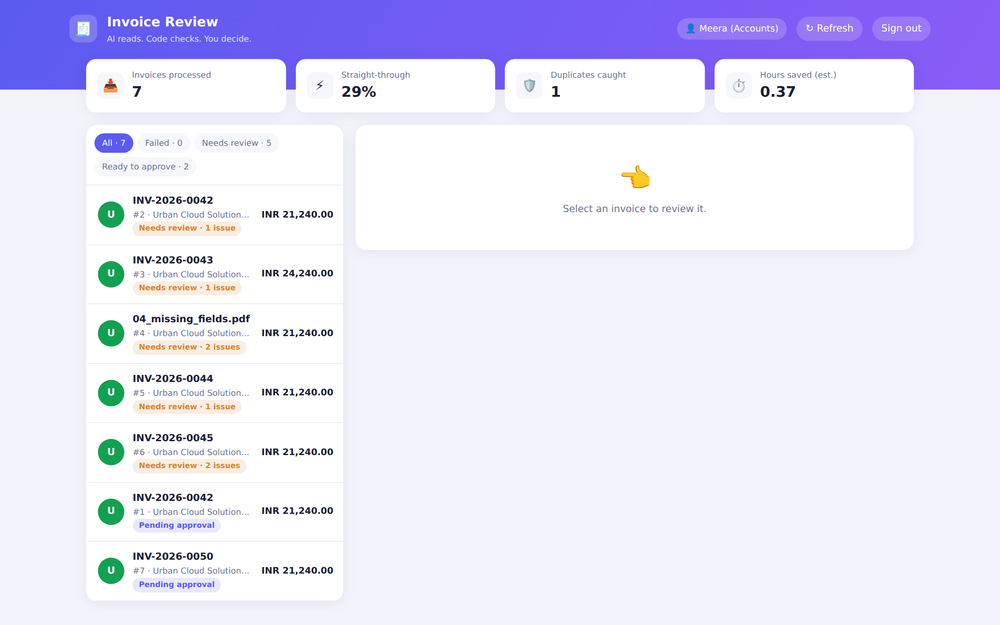
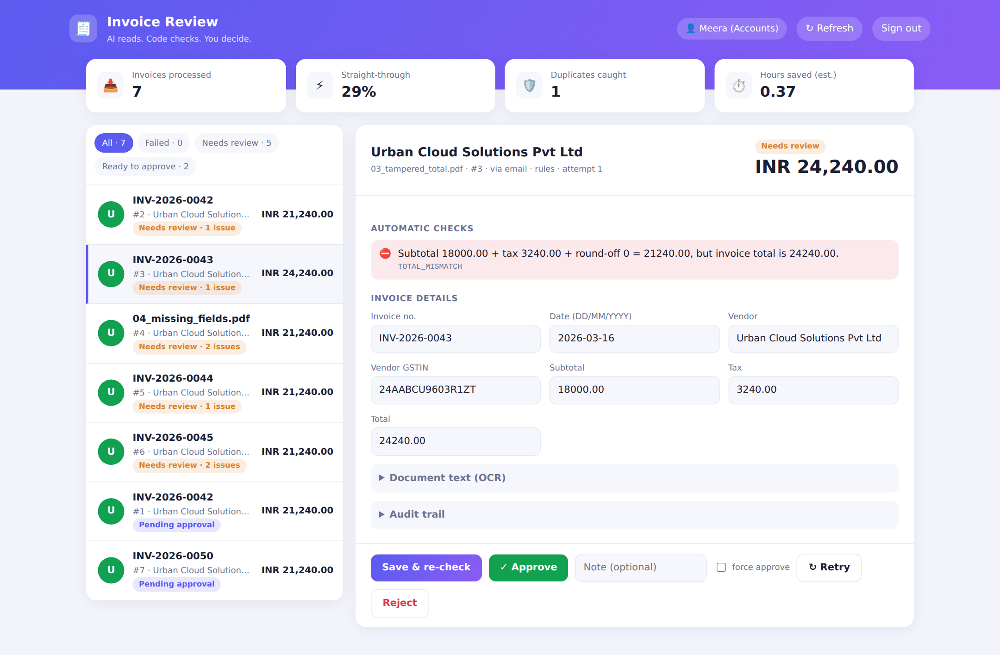
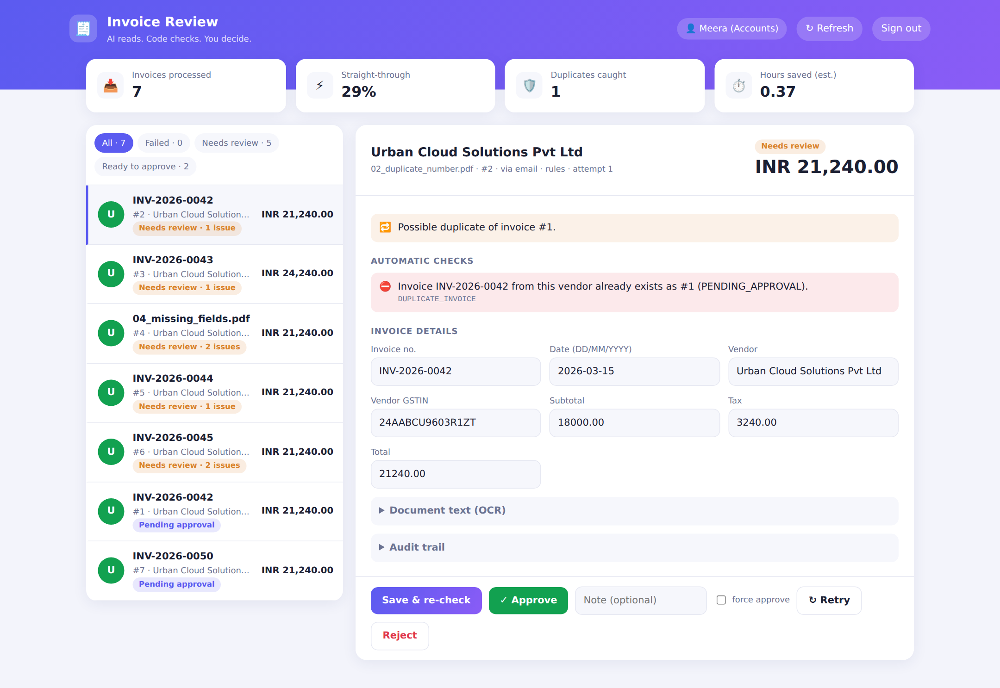
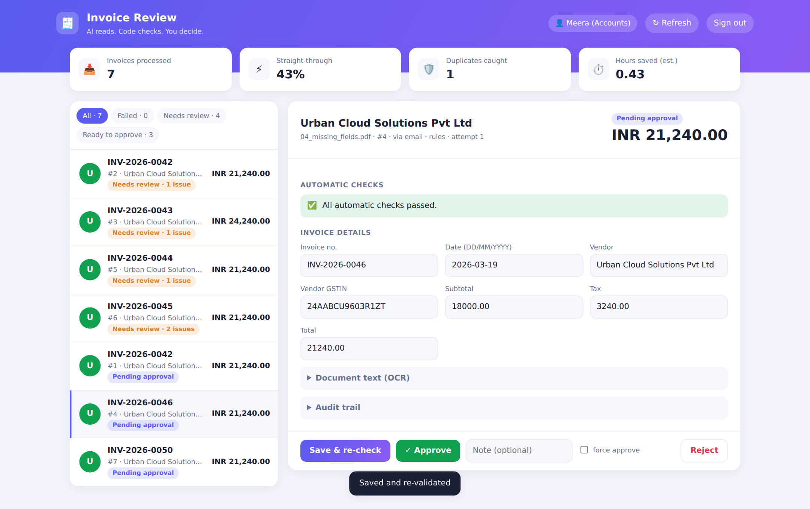

# AI Invoice Processing Automation

Turns a pile of PDF / scanned invoices into **validated, de-duplicated, approval-ready records** in PostgreSQL, and gives the finance team a short queue of *only* the invoices that need a human.

> **Design rule: AI reads, code decides.**
> An LLM (or the offline rule engine) only *copies* printed values off the page. Every amount, tax and total is then re-checked by plain deterministic `Decimal` arithmetic, and nothing is ever approved by the AI. A human clicks Approve. Auto-approval exists but is **off by default** and is rule-based, never confidence-based.

---

## What it saves (for the client)

| # | Manual process | With this system |
|---|---|---|
| 1 | Open email, download attachment | Automatic (n8n watches the inbox) |
| 2 | Open file, find the fields | Automatic (OCR + extraction) |
| 3 | Type invoice no., date, vendor, amount into sheet/ERP | Automatic |
| 4 | Re-add line items and GST on a calculator | Automatic, exact to the paisa |
| 5 | Search old records for a duplicate | Automatic (same file, same number, fuzzy vendor, same date+amount) |
| 6 | Check the GSTIN looks right | Automatic (format **and** checksum) |
| 7 | Chase / flag problem invoices | Routed to a review queue with the exact reason |
| 8 | Approve | **One click** (the only step that stays human, by design) |
| 9 | File it | Stored with original file and full audit trail |
| 10 | Build the month-end report | `GET /reports/summary`, CSV export, daily email via n8n |

**About 9 of 10 manual steps disappear for a clean invoice.** `GET /reports/summary` computes the saving for the client's own volume from editable assumptions.

Illustrative example (assumptions, not a measurement): 500 invoices/month at 8 min each by hand = 66.7 h. If 70% pass straight through (2 min to approve) and 30% need a fix (6 min), that becomes 26.7 h. That is about **40 h/month saved (60%)**, roughly ₹12,000/month at ₹300/h. Tune `MANUAL_MINUTES_PER_INVOICE`, `REVIEW_MINUTES_PER_INVOICE`, `CORRECTION_MINUTES_PER_INVOICE`, `HOURLY_COST` to the client's reality, and replace them with measured numbers after a pilot week.

---

## Screenshots

The review screen (`/review`) is what the finance team uses day to day. Real captures from a live run (`python -m scripts.take_screenshots`):

| Queue and live stats | Tampered total caught |
|---|---|
|  |  |
| **Duplicate detected** | **Human fixes missing fields, checks re-run** |
|  |  |

More in `docs/screenshots/`: sign-in, clean invoice, invalid GSTIN, scanned image via OCR, approved state, filters, dark mode.

## How it works

```
 Email / folder / API
        |  (n8n)
        v
 POST /invoices/upload --> SHA-256 file hash --> exact re-upload? --> 409
        |
        v
   Text extraction: native PDF text, else Tesseract OCR (scans, PNG/JPG/TIFF)
        |            (retry with exponential backoff on transient errors)
        v
   Structured extraction: LLM (Claude API, temperature 0, "copy, don't calculate")
        |                  on failure -> offline rule engine + warning
        v
   DETERMINISTIC VALIDATION (no AI)            DUPLICATE DETECTION
   required fields, dates, GSTIN checksum      same no. + similar vendor
   qty x rate, sum(lines) = subtotal           same vendor + date + amount
   tax vs rate, CGST = SGST, sum = total       (rejected/failed ignored)
   GROUNDING: every amount and invoice no.
   must literally appear in the OCR text
        |
        +-- any error ---> NEEDS_REVIEW ---> human /correct (re-validated) -> approve | reject
        +-- clean -------> PENDING_APPROVAL -> human /approve
        +-- tech failure -> FAILED --------> auto-retry, then /retry or hourly n8n job
```

### Why the grounding check matters
A hallucinated total can be *internally consistent* (subtotal + tax = total all add up) and still be invented. So each extracted amount and the invoice number must also be found in the document text; otherwise the invoice is flagged `AMOUNT_NOT_IN_SOURCE`. OCR misreads (`1,620` read as `1,520`) are caught the same way, or by the arithmetic.

### Validation rules

| Code | Severity | Rule |
|---|---|---|
| `MISSING_FIELD` | error | invoice number, date, vendor, total are required |
| `UNREADABLE_VALUE` | error | value present but unparseable (ambiguous amounts like `1.234,56` are refused, never guessed) |
| `FUTURE_DATE` / `STALE_DATE` | error / warn | date after today / older than `MAX_INVOICE_AGE_DAYS` |
| `INVALID_AMOUNT` | error | total <= 0 or any component negative |
| `LINE_AMOUNT_MISMATCH` | error | qty x rate != line amount |
| `LINE_ITEMS_MISMATCH` | error | sum of line amounts != subtotal |
| `TAX_MISMATCH` | error | tax != subtotal x rate; CGST != SGST; IGST mixed with CGST/SGST; tax != components |
| `TOTAL_MISMATCH` | error | subtotal + tax + round-off != total (tolerance `AMOUNT_TOLERANCE`, default 0.05) |
| `INVALID_GSTIN` | error | bad format or failed checksum |
| `AMOUNT_NOT_IN_SOURCE` / `VALUE_NOT_IN_SOURCE` | error | grounding check |
| `DUPLICATE_INVOICE` | error | same invoice no. from same/similar vendor |
| `POSSIBLE_DUPLICATE` | warn | same vendor + date + amount, different number |
| `IRREGULAR_TAX_RATE`, `HIGH_VALUE`, `NO_BREAKDOWN`, `UNSUPPORTED_CURRENCY`, `LLM_FALLBACK` | warn | shown to the approver; block auto-approval |

**Human override policy:** money-math, duplicate and missing-data errors **cannot** be force-approved. The reviewer must fix the data via `/correct` (which re-runs validation) or reject. Other errors (for example a GSTIN verified on the portal) can be force-approved with `force=true` and a written note. The original extraction, every correction, the reviewer and timestamps are kept for audit.

---

## Run locally (no Docker, easiest)

```bash
# 1. one-time system dependency for scanned images / scanned PDFs
brew install tesseract            # macOS   |   Ubuntu: sudo apt install tesseract-ocr

# 2. Python environment (Python 3.11 or 3.12 recommended)
python3 -m venv .venv && source .venv/bin/activate
pip install -r requirements-dev.txt

# 3. config (uses SQLite automatically, no database setup needed)
cp .env.example .env              # API_KEY inside is your login key for the UI

# 4. start
uvicorn app.main:app --reload     # or: make run
```

Open **http://127.0.0.1:8000** (redirects to the review console). Sign in with the `API_KEY` from `.env` and your name,
click **Upload invoice**, and pick files from `samples/`. Swagger is at `/docs` (click **Authorize** and paste the key).

### Using a real AI: Claude, ChatGPT or Gemini
Works with whichever key the client gives you. Two ways:

**A. Live in the browser (best for a demo, nothing to edit or restart)**
1. Open the review screen and click **⚙** in the header.
2. Pick the provider, paste the key, click **Load models** (this also proves the key works), pick a model.
3. Click **Save & test**. It makes one real call and shows what the AI read. New uploads now use it.

The key is held in server memory only, never written to disk, and is forgotten when the server restarts. Use **Remove pasted key** at the end of the demo.

**B. In `.env`** (permanent): set `ANTHROPIC_API_KEY`, `OPENAI_API_KEY` or `GEMINI_API_KEY`, optionally `LLM_PROVIDER` and the model, then restart. Test with `python -m scripts.check_llm [anthropic|openai|gemini]`.

Each invoice shows which engine read it (`llm:gemini`, `llm:openai`, `llm:anthropic` or `rules`). With `EXTRACTION_MODE=auto`, an AI failure falls back to the offline extractor and adds an `LLM_FALLBACK` warning; use `llm` to fail loudly instead.
Invoice text is sent to the chosen provider's API. The AI only *reads*: totals, GSTIN, duplicates and "is this number really on the document" are re-checked by code.
Default model names change often; if one is rejected, use **Load models** to pick one your key can use.

## Quick start

```bash
git clone <your-repo> ai-invoice-processing-automation && cd ai-invoice-processing-automation
cp .env.example .env           # set POSTGRES_PASSWORD and API_KEY; add ANTHROPIC_API_KEY for LLM extraction
docker compose up --build -d   # Postgres + API (http://localhost:8000/docs) + n8n (http://localhost:5678)
python -m scripts.demo --key "$API_KEY"
```

Without an `ANTHROPIC_API_KEY` the system runs fully offline on the rule-based extractor, which handles typed invoices well. The LLM adds robustness for messy layouts.

Demo output (files in `samples/`, real run against a live server):

```
file                         status            issues
01_clean_invoice.pdf         PENDING_APPROVAL  -
02_duplicate_number.pdf      NEEDS_REVIEW      DUPLICATE_INVOICE
03_tampered_total.pdf        NEEDS_REVIEW      TOTAL_MISMATCH
04_missing_fields.pdf        NEEDS_REVIEW      MISSING_FIELD
05_bad_gstin.pdf             NEEDS_REVIEW      INVALID_GSTIN
06_line_math_error.pdf       NEEDS_REVIEW      LINE_AMOUNT_MISMATCH, LINE_ITEMS_MISMATCH
07_scanned_image.png         PENDING_APPROVAL  -   (real Tesseract OCR)
```

Local development without Docker: `make install && make test` (SQLite is used automatically; the image test needs `tesseract-ocr`).

## API

**Review screen for non-technical users:** open `http://localhost:8000/review`, enter the API key and your name. You get the queue, the checks that failed, editable fields, and Approve / Reject / Retry buttons. Swagger remains at `/docs` for developers. Send `X-API-Key` on every call except `/health`.

| Method and path | Purpose |
|---|---|
| `POST /invoices/upload` | process one file (PDF/PNG/JPG/TIFF); returns the status immediately |
| `GET /invoices`, `/invoices/{id}`, `/invoices/{id}/logs` | list / detail (raw text, original vs corrected data) / processing log |
| `GET /invoices/review-queue` | FAILED, then NEEDS_REVIEW, then PENDING_APPROVAL |
| `POST /invoices/{id}/correct` | human edits fields; validation re-runs in code |
| `POST /invoices/{id}/approve`, `/reject` | human decision (reviewer name recorded) |
| `POST /invoices/{id}/retry`, `/invoices/retry-failed` | re-run on the stored file |
| `GET /reports/summary`, `/reports/invoices.csv` | status counts, amounts, top issues, time saved / export |

## n8n

Import `n8n/invoice_workflow.json` and attach your IMAP and SMTP credentials:
1. **Email arrives, upload attachment, alert accounts** (needs review vs ready to approve)
2. **Daily 6 pm, `/reports/summary`, email report**
3. **Hourly, `/invoices/retry-failed`**

Note: the workflow was generated programmatically and not run inside a live n8n instance. Node versions may need a nudge on import, so treat it as a ready starting point.

## Reliability

* **Retry:** OCR and LLM calls retry transient failures (network, HTTP 429/5xx, unparseable LLM reply) with exponential backoff (`MAX_ATTEMPTS`, `RETRY_BASE_DELAY`). Permanent errors (bad key, corrupt PDF) fail fast.
* **Graceful degradation:** LLM down, so the rule extractor takes over with an `LLM_FALLBACK` warning. In `EXTRACTION_MODE=llm` it ends in `FAILED` instead, and stays retryable.
* **Bad data never causes a 500:** a corrupt file becomes `FAILED` with the reason, and the stored file lets you retry later.
* **Processing log:** each step (`received`, `ocr`, `extract`, `validate`, `correction`, `approval`, `retry`) is persisted the moment it happens.
* **Money is `Decimal` / `NUMERIC(14,2)` end to end.** No floats.

## Tests

`python -m pytest -q` runs **70 tests**: money/date parsing, every validation rule, GSTIN checksum, grounding, rule and LLM extraction (mocked HTTP: retry, fallback, fenced JSON, bad key), retry backoff, and the full API flow (duplicates, human approval, force-approve limits, correction re-validation, retry, auto-approve policy, auth, reports, real OCR of a scanned image).

The LLM path is tested against a mocked HTTP layer, not the live Anthropic API.

## Configuration

All settings are environment variables. See `.env.example`.

## Limitations and next steps

* Tuned for GST-style invoices (GSTIN, CGST/SGST/IGST). Other tax regimes need rule additions. Dates are day-first by default (`DATE_DAYFIRST`).
* The rule extractor expects a conventional layout. Stylised or handwritten invoices should use LLM mode and will often land in review, by design.
* Tables are created with `create_all`. Add Alembic migrations before evolving the schema in production.
* Processing is synchronous per upload (fine for hundreds a day). Move to a queue (Celery/RQ) for bulk volumes.
* The review screen is a single static HTML page (no login system; it relies on the shared API key). Add per-user login before exposing it beyond a trusted team.
* ROI numbers are configurable estimates. Validate them with a pilot.

## Structure

```
app/            FastAPI app, models, schemas
app/services/   ocr, extraction, validation, duplicates, pipeline, reports
tests/          70 tests            scripts/   sample generator + demo runner
n8n/            importable workflow  samples/   7 demo invoices
```
